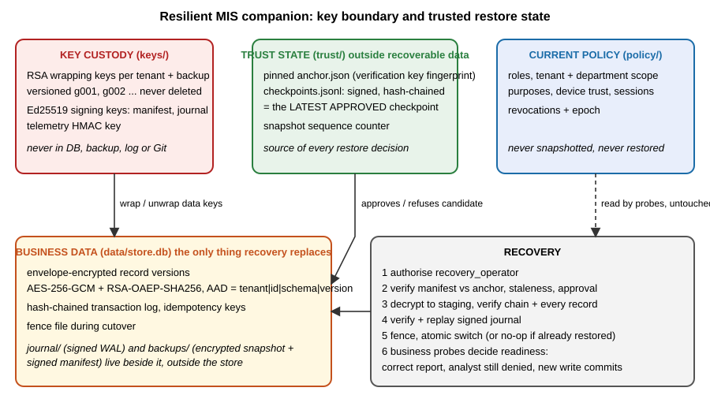

# Architecture

The diagram is original. It shows the three trust zones this companion enforces and which one each restore decision comes from.

## Zones

| Zone | Where | Contains | Rule |
|---|---|---|---|
| **Key custody** | `keys/` | RSA wrapping keys (per tenant + backup, versioned), Ed25519 signing keys (manifest, journal), telemetry HMAC key | Never in the database, a backup, a log, the repository or a snapshot. Rotation keeps every old generation. |
| **Trust state** | `trust/` | Public keys, pinned `anchor.json`, `checkpoints.jsonl` (hash-chained, signed), snapshot sequence counter | Lives OUTSIDE the recoverable data, so restoring cannot rewind it. This is the "source of trusted restore state". |
| **Current policy** | `policy/policy.db` | Roles, tenant/department scope, purposes, device trust, sessions, revocations | Separate database. A snapshot never contains it and recovery never writes it, so a restore cannot reactivate old privileges. |
| **Business data** | `data/store.db` | Envelope-encrypted record versions + hash-chained transaction log | The only thing snapshots capture and recovery replaces. |
| **Journal / backups / probes** | `journal/`, `backups/`, `probes/` | Signed write-ahead journal, encrypted snapshots + signed manifests, probe records and client ledger | Outside the store being restored. |

## Request path (CLI and HTTP share it)

`session token -> PolicyStore.decide (fresh read: role, tenant, department, purpose, device) -> store -> decrypt (AAD = tenant|record|schema|version) -> identity check -> aggregate -> telemetry`

Authorisation happens before any decryption, aggregation, export or restore. A denied request and a missing record return the same `AccessDenied` message.

## Write path

`authorise -> seal (fresh AES-256-GCM key + nonce, RSA-OAEP-SHA256 wrap, label = SHA-256(AAD)) -> BEGIN IMMEDIATE (idempotency key, expected version, chain hash) -> COMMIT -> journal append + fsync -> acknowledge`

Data-loss boundary: a crash between COMMIT and journal fsync loses only an unacknowledged write.

## Recovery path

1. authorise a `recovery_operator`
2. choose the latest APPROVED checkpoint (or a named candidate)
3. verify: pinned anchor, Ed25519 manifest signature, file digests, schema, tenant scope, staleness (sequence vs approved chain), approval record
4. decrypt to `staging/`; verify SQLite integrity, hash chain, every record decrypts with its identity binding, versions are contiguous, business digest equals the signed manifest
5. verify and replay the signed journal (each entry must extend the restored chain); a damaged journal is rejected and the snapshot is used alone
6. if the active store is healthy and already contains the restored history: do nothing (retries are no-ops and later writes survive); if healthy but different: refuse
7. fence, drain, two-step atomic switch (rollback on failure), unfence
8. **only then** run the business probes. Recovery is not "ready" until the manager gets the correct report, the revoked analyst is still denied and a new valid write commits.

If any step before 7 fails, the active state is untouched byte for byte.

## Trust model limits

* Private keys are PEM files with owner-only permissions (best effort on Windows); `MIS_KEY_PASSPHRASE` encrypts them at rest but then lives in the process environment. Anyone who can read `keys/` can decrypt everything. Production use needs an HSM/KMS.
* Recovery-key retention: losing a retired wrapping key makes every backup and record sealed under it unreadable. `rotate` never deletes keys; back up `keys/` separately from `backups/`.
* The approved-checkpoint chain is signed by the manifest key, so an attacker holding that key can approve a malicious snapshot. The pinned `anchor.json` should be copied to somewhere the service cannot write.
* Telemetry pseudonyms are keyed HMACs, not anonymisation.
* The HTTP adapter has no TLS and is for localhost demonstration only.
* A laptop run does not establish enterprise or cloud behaviour.
